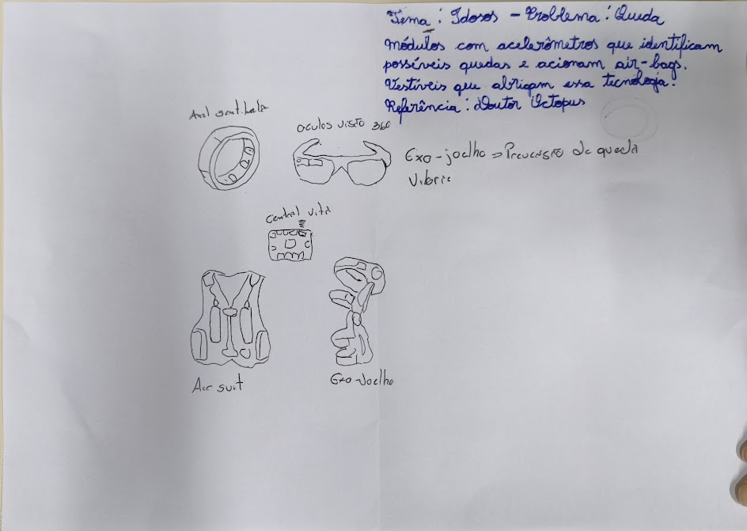
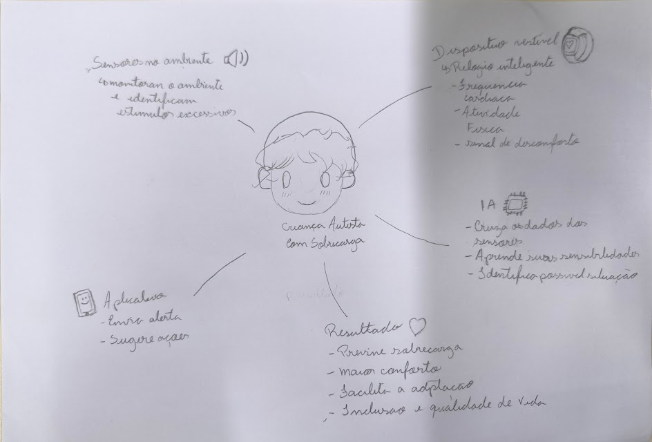
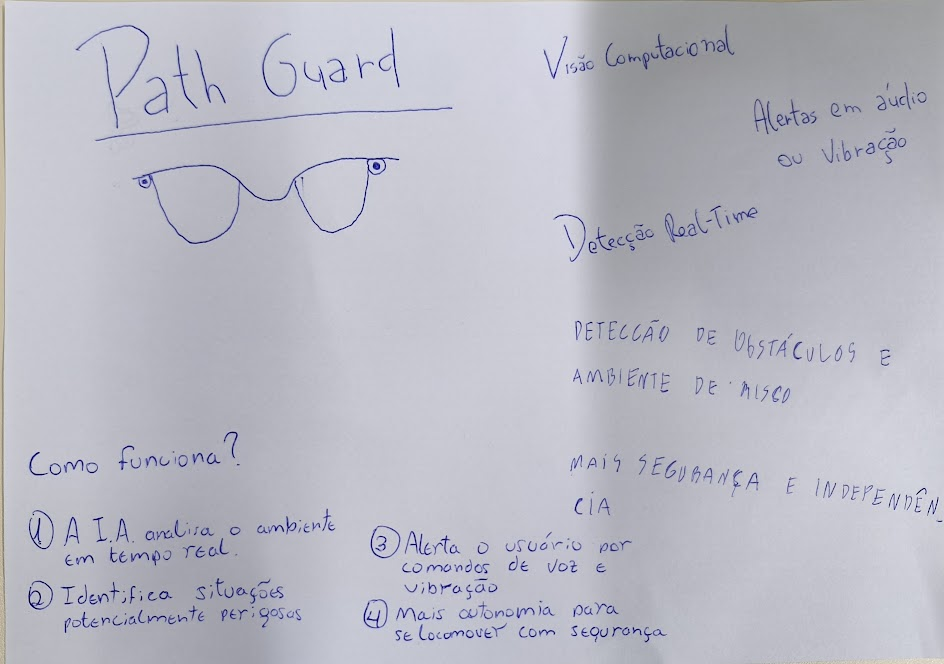
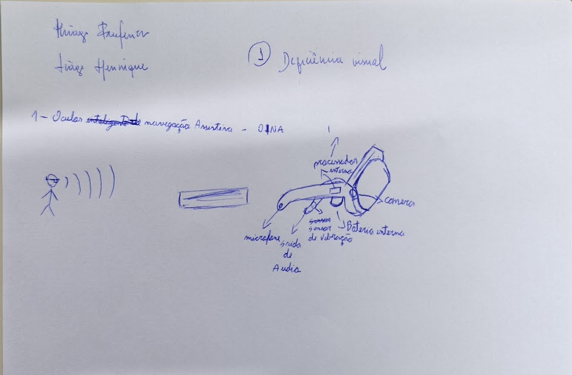
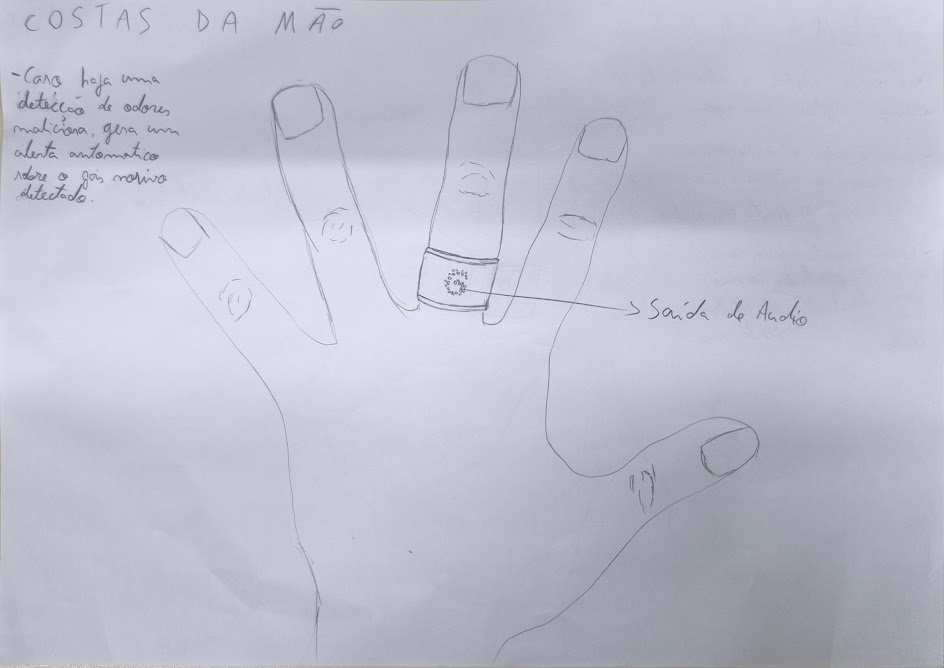

## Conteúdo da aula
Aula: 30/10

## Material da aula  

- Material da atividade: [pdf](atividade/desafio.pdf)

## Atividade  

**Projetar e mapear um novo modelo** de interação humano-computador
impulsionado por Inteligência Artificial, focado em resolver um desafio crítico de acessibilidade e inclusão para pessoas com deficiência ou necessidades específicas.

**As Regras do desafio:**  

- Não se prenda às limitações tecnológicas atuais.
- O foco é a necessidade humana e o modelo mental de uso.
- A equipe deve ter apenas papel e caneta para projetar a estrutura da solução.

### Abaixo Fotos das apresentações feitas:

**ideia:** Idosos - Problemas de queda

**ideia:** Crianças autistas

**ideia:** Visão computacional

**ideia:** Visão ampliada

**ideia:** Anel sensor

